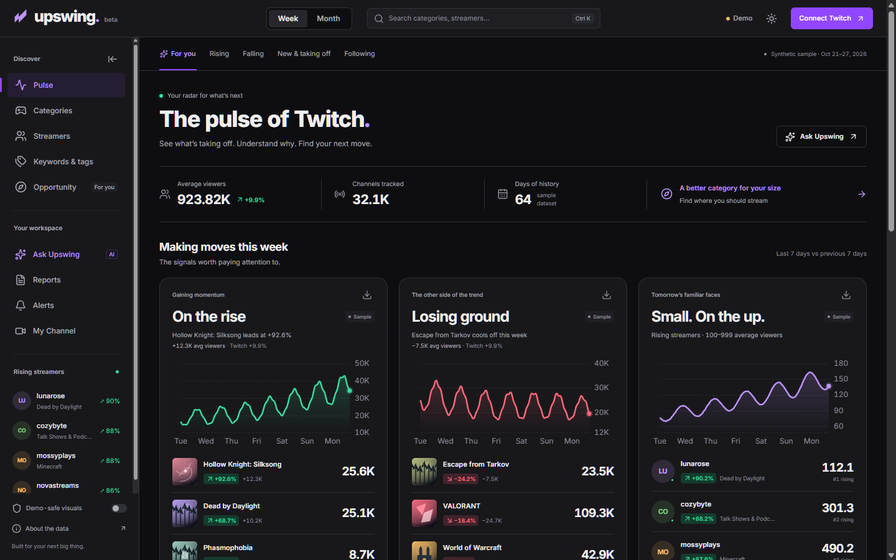
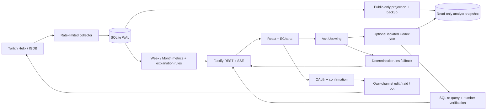

# Upswing

**See what’s taking off on Twitch, and why.**

Upswing is a trend radar for streamers: Week/Month comparisons, visual trend cards, a category market map, opportunities at your audience size, evidence-based explanations, and an in-app analyst. Connect your own Twitch channel to edit its title/category, enable command replies, and preview OBS overlays.



## Try the keyless demo

Node **22+** (verified on Node 24), npm, and Git are required.

```sh
git clone https://github.com/Darthh/TwitchTrendTracker-Hackathon2026.git && cd TwitchTrendTracker-Hackathon2026
npm install
npm run demo
```

Open **http://localhost:3000**. `npm run demo` builds the client and starts one Node service. It creates a deterministic 64-day **synthetic** fixture database at `data/demo.db`; it requires no accounts, API keys, paid services, or external images. The fixture manifest is committed in `data/sample/manifest.json`. These are fictional observations, not real Twitch history, and the demo analyst is explicitly labeled **Rules analyst**, not cached Codex. Twitch write actions and OAuth are disabled in demo mode.

Use Week/Month in the top bar; browse category details; change your size in Opportunity; ask a suggested question; try Title Lab; backtest and approve a threshold alert; send `!trending` in My Channel’s **mock chat**. Trend-card download produces a 1080 × 1350 PNG. Light/dark theme, watchlists and demo-safe visuals persist locally.

## Live setup

1. Register an app in [Twitch Developer Console](https://dev.twitch.tv/console/apps). Set its OAuth redirect to `http://localhost:3000/auth/twitch/callback` for local use. Use the same origin in `PUBLIC_URL` and your browser.
2. Copy `.env.example` to `.env`. Set your client ID and secret. Generate a fresh 32-byte hex value for **each** of `TOKEN_ENC_KEY` and `SESSION_SECRET` with `node -e "console.log(require('crypto').randomBytes(32).toString('hex'))"`. Keep this file local.
3. Run `npm run build` and `npm start`. With credentials and `WORKER=true`, the collector starts automatically. `npm run dev` uses Vite middleware/HMR in the same process.
4. Run `npm run collect:once` to inspect a poll, then `npm run backfill:clips` for the top 300 categories across eight weeks. `npm run collect` is an alternative standalone worker; a database lease prevents concurrent global polls. On a separate web process use `WORKER=false`.
5. Connect Twitch. Basic login requests no write scopes. Enable permissions from **My Channel** only when needed. Review the title/category diff or raid target before confirming. Chat replies are sent as the authenticated broadcaster; a separate bot-account flow is not implemented.

Live data starts empty. Twitch does not supply historical concurrent audience data. Full Week comparisons require two covered weeks; Month requires two covered 30-day windows. Until then, supported partial comparisons are labeled with the actual baseline; otherwise change is unavailable. Keeping the collector running is your deployment responsibility.

### Environment

| Variable                                              | Purpose / default                                                                          |
| ----------------------------------------------------- | ------------------------------------------------------------------------------------------ |
| `TWITCH_CLIENT_ID`, `TWITCH_CLIENT_SECRET`            | Live Helix collection and OAuth; server only                                               |
| `TWITCH_REDIRECT_URI`                                 | `http://localhost:3000/auth/twitch/callback`                                               |
| `TOKEN_ENC_KEY`                                       | 64 hex characters; AES-256-GCM key for tokens at rest                                      |
| `SESSION_SECRET`                                      | At least 32 characters; signed httpOnly SameSite=Lax cookies                               |
| `PUBLIC_URL`                                          | Canonical origin, default `http://localhost:3000`; mutation Origin checks use it           |
| `PORT`, `HOST`                                        | `3000`, `127.0.0.1`; container sets HOST to `0.0.0.0`                                      |
| `POLL_INTERVAL_MIN`, `WATCHED_POLL_SEC`               | Global poll every 10 minutes; connected-channel poll every 120 seconds                     |
| `MIN_VIEWERS`, `MAX_PAGES`                            | Global pagination floor 15; cap 400 pages; sample coverage is not the entire platform      |
| `DEEPSCAN_GAMES`                                      | 150; category scans distributed across the hour                                            |
| `RAW_RETENTION_DAYS`                                  | 21; hourly/daily rollups remain                                                            |
| `WORKER`                                              | `true`; `false` disables the collector in the web process                                  |
| `CODEX_API_KEY`, `CODEX_MODEL`                        | Optional server-side Codex API key/model; no live calls by default                         |
| `CODEX_LIVE`, `CODEX_ISOLATED`                        | Both must be `true` on an isolated Linux deployment to allow the SDK runner; default false |
| `CODEX_MAX_RUNS_PER_HOUR`                             | Global limit 10; at most two live analyses concurrently; public route limit 12 per IP/hour |
| `BOT_USERNAME`                                        | Reserved; current bot sends as the connected broadcaster                                   |
| `OPENAI_API_KEY`, `OPENAI_MODEL`, `OPENAI_WEB_SEARCH` | Reserved for optional outside-news context; not used in this build                         |

### Scopes

| Enable from My Channel    | Requested scopes                    | Why                                                               |
| ------------------------- | ----------------------------------- | ----------------------------------------------------------------- |
| Basic login               | None                                | Public profile and a private app session                          |
| Authorize channel editing | `channel:manage:broadcast`          | Apply title/category; server also accepts validated optional tags |
| Authorize raids           | `channel:manage:raids`              | Raid only from the authenticated broadcaster                      |
| Authorize chat            | `user:read:chat`, `user:write:chat` | EventSub command reads and chat replies as that broadcaster       |

Permissions are incremental; previously granted scopes are retained on reauthorization. Tokens are refreshed server-side, encrypted at rest and never returned to the browser. Mutations require same-origin requests and explicit confirmation. Opt-out excludes the connected channel from named analytics, future collection and analyst snapshots; aggregate historical category totals remain anonymous.

## Runtime analyst

The implementation uses the installed [Codex TypeScript SDK](https://developers.openai.com/codex/sdk) and its inspected TypeScript definitions. It sends `runStreamed` progress through SSE and validates structured output with Zod. The SDK includes the Codex CLI dependency; see `npm ls @openai/codex`.

Live execution is **disabled on Windows and by default everywhere**. Before enabling it, use a dedicated Linux container/host without unrelated secrets or host mounts, verify its sandbox supports deny-read filesystem rules, and validate it with your own API account. A boolean flag does not create OS/container isolation. This session did not exercise a paid live run or prove a deployed sandbox.

The runner supplies a clean temporary HOME, scrubbed SDK environment, no inherited tool-shell environment, a named read-only filesystem profile that denies the root and grants only runtime libraries, the public analyst workspace and dependencies, disabled tool networking/web search, a 120-second deadline, and no approvals. Unsupported sandbox settings fail into the rules fallback. Do not relax sandbox settings to make a deployment pass.

Only public tables enter `analyst/db/upswing-ro.db`. A SQLite in-memory projection is saved with the backup API and atomically installed; accounts, sessions, tokens and user prompts never enter the snapshot. SQL must be one bounded SELECT against an approved table, with no joins/subqueries/extensions/writes. A read-only worker is terminated on timeout. Every accepted numeric finding is queried again. The app constructs displayed numeric claims from verified result fields and withholds unchecked model narrative/charts.

`npm run warm-codex -- --demo` warms eight deterministic **rules** answers. Live `npm run warm-codex` can cache real runs only after the isolated runtime is configured. No real Codex results are fabricated. Monday 9 AM Pacific and first-of-month 9 AM jobs can store reports while the server is running. Simple threshold alerts run hourly after approval; complex natural-language SQL compilation was cut.



## Metrics

- **Week / Month:** coverage-weighted hourly means over 7/30 days versus the preceding 7/30 days. Full comparisons require 90% coverage in both windows. Partial Week uses separate complete daily blocks, preferring matching weekday; partial Month uses separate first/last complete tracked weeks.
- **Relative change:** `(1 + categoryChange) / (1 + sampledPlatformChange) − 1`. Both signed absolute and percentage changes are shown.
- **Support:** category average ≥200 in both windows; channel baseline ≥50 and two broadcasts in each window; keyword ≥15 distinct channels.
- **Breakout:** `log2(current / previous) × min(1, sessions / 3)`, current average ≥100. Raid patterns use +40% and +100 viewers; retained spikes require 30 minutes above 1.3× baseline with continuous observations.
- **Opportunity:** percentile-weighted discoverability 35%, relative growth 25%, smaller-channel demand 25%, audience distribution 15%. Deep scans and supported comparisons are required. Directory rank is an estimate, not a promised search position.
- **Why:** exact log supply/demand identity; measured channel contributions; an explicit unattributed remainder. The UI never invents external causes. Migration flow math exists with conservation tests; a user-facing Sankey was cut.
- **Titles:** multilingual tokenization, commands, emoji, bigrams and within-channel median lift utilities. Live keyword lift is withheld without controls; sample lifts are synthetic. Title Lab scores clarity heuristically, not expected growth.
- **Best time:** observed average viewers per channel by local day/hour, with missing cells left empty. This is descriptive demand/supply, not a causal recommendation.

## Commands and verification

| Command                                   | Behavior                                                              |
| ----------------------------------------- | --------------------------------------------------------------------- |
| `npm run check`                           | TypeScript, ESLint, Vitest                                            |
| `npm run smoke`                           | In-process keyless API smoke, ranges, cached analyst, mutation guards |
| `npm run report [-- --demo]`              | Week/Month ranking and a rules explanation; live mode starts empty    |
| `npm run collect:once`, `npm run collect` | One real poll or continuous collection; credentials required          |
| `npm run backfill:clips`                  | Eight weekly top-100 clip samples for up to 300 categories            |
| `npm run bot`                             | Safe instructions; bot activation remains an explicit UI action       |
| `npm run export-sample [-- --demo]`       | Public analytics only to ignored `data/export.json`                   |
| `npm run import-sample`                   | Imports approved public tables from that reviewed local export        |
| `npm run warm-codex [-- --demo]`          | Warms eight correctly labeled local analyst results                   |

Tests cover comparisons and seasonality, opportunity, tokenization, raid patterns, session closing, pagination duplicates, 429 retries, disappearance within covered polls, exact decomposition, leave-one-out, flow conservation, detector fixtures, SQL restrictions, wrong-number rejection, authenticated encryption, injection resistance, bot cooldowns and snapshot exclusion. See [implementation status](docs/STATUS.md) for exact evidence and remaining cuts.

## Hosting

**Always-on service:** build the included Dockerfile, attach persistent volumes at `/app/data` and `/app/analyst/db`, set environment secrets in the host, `HOST=0.0.0.0`, and `PUBLIC_URL`/redirect URI to your HTTPS origin. Run one collector process. Railway, Render or Fly can host this pattern; no paid service was created or deployed by this implementation. The container recipe has not been run in this Windows session.

**Your PC + Cloudflare Tunnel:** keep `npm start` running and use your own tunnel to `http://localhost:3000`; update PUBLIC_URL and the Twitch redirect to the HTTPS tunnel hostname before connecting accounts. Use an always-on PC and stable tunnel if judges need access. Do not enable live Codex on this Windows host.

## How Codex was used

Build-time work in this thread created the application, mathematical and security tests, documentation, screenshots, local verification and Git delivery. The original brief is preserved verbatim in [docs/PROMPT.md](docs/PROMPT.md); [CODEX_LOG](docs/CODEX_LOG.md) records outcomes without inventing live evidence. No parallel agents were spawned. The manually dispatched review workflow passes its API key only to the Codex action, reviews a diff as untrusted text, and does not execute PR code with a job-level key.

Runtime Codex is an implemented optional SDK path with streaming, caching and numeric verification; the delivered no-key experience uses labeled rules. Optional features that were cut include arbitrary custom charts, full growth-plan feedback, complex alert compilation, raid fit by language/category, automatic 30-minute change-impact attribution, candlesticks, migration Sankey, and outside news search. No live Twitch write, OAuth account connection, real collection, paid Codex invocation, public deployment, submission or video upload was performed. [DEMO_SCRIPT](docs/DEMO_SCRIPT.md) and [DEVPOST](docs/DEVPOST.md) distinguish the working demo from footage still needed on an authorized test channel.

Upswing is independent and is not affiliated with or endorsed by Twitch. Public metadata enrichment uses [IGDB](https://www.igdb.com/). All included illustrations are original geometric SVGs, not copied game covers or Twitch brand assets. MIT license.
