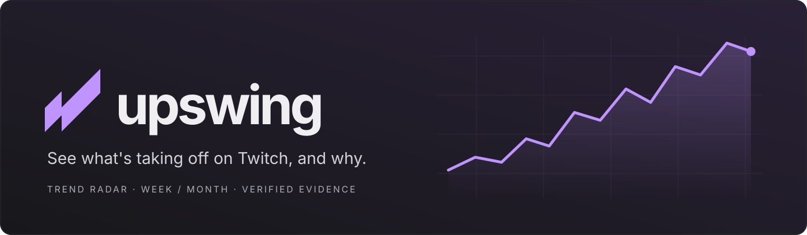
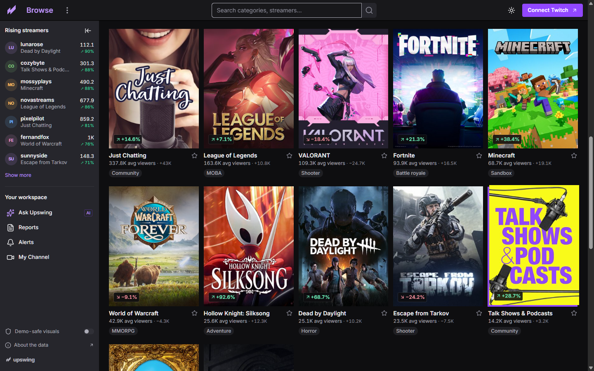
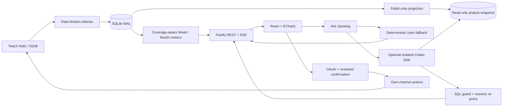

<p align="center">
  
</p>

<h1 align="center">Upswing</h1>

<p align="center">
  <strong>A trend radar for your next stream.</strong><br>
  Follow the audience. Understand the movement. Find an opportunity at your size.
</p>

<p align="center">
  <a href="https://github.com/Darthh/TwitchTrendTracker-Hackathon2026/actions/workflows/check.yml"></a>
  <a href="LICENSE"></a>
  <a href="#getting-started"></a>
  <a href="#demo-walkthrough"></a>
</p>

Built for the 2026 hackathon, Upswing combines a Twitch-inspired directory with Week/Month analytics, shareable trend cards, an opportunity map, and an in-app analyst. A single Node service serves the interface, API, SQLite database, and collection jobs.

**Status: locally verified hackathon prototype.** The keyless demo uses deterministic **synthetic observations** and a labeled **Rules analyst**. Live Twitch collection, OAuth, own-channel actions, and an optional isolated Codex runtime are implemented integration paths, but have not been exercised against authorized live accounts in this project session. No public deployment is claimed. See [implementation status](docs/STATUS.md) for the exact evidence and remaining work.

<p align="center">
  
</p>

## Contents

- [Why Upswing exists](#why-upswing-exists)
- [What the project implements](#what-the-project-implements)
- [Architecture and trust boundaries](#architecture-and-trust-boundaries)
- [How a trend becomes a decision](#how-a-trend-becomes-a-decision)
- [Metrics and evidence](#metrics-and-evidence)
- [Dashboard and API](#dashboard-and-api)
- [Technology and repository map](#technology-and-repository-map)
- [Credentials and configuration](#credentials-and-configuration)
- [Getting started](#getting-started)
- [Verification and design evidence](#verification-and-design-evidence)
- [Deployment](#deployment)
- [Demo walkthrough](#demo-walkthrough)
- [Commands and maintenance](#commands-and-maintenance)
- [Troubleshooting](#troubleshooting)
- [Limitations and live verification](#limitations-and-live-verification)
- [How Codex was used](#how-codex-was-used)
- [Contributing and license](#contributing-and-license)

## Why Upswing exists

A crowded category is not always a good category for a small channel. A rising viewer count can reflect one large broadcast, more channels going live, or a platform-wide change. A leaderboard alone does not explain which of those happened.

Upswing puts the comparison, its coverage, and its measured contributors alongside the ranking. Streamers can browse what changed, inspect why, and compare opportunities for their own audience size before acting.

## What the project implements

| Capability                   | What you can do                                                                                                    | Evidence boundary                                                                                      |
| ---------------------------- | ------------------------------------------------------------------------------------------------------------------ | ------------------------------------------------------------------------------------------------------ |
| Pulse and trend cards        | Compare gaining categories, cooling categories, and rising streamers; download a 1080 × 1350 card                  | Week and Month only; demo results are synthetic                                                        |
| Category directory           | Search, filter by genre, sort, follow categories, and switch between covers and a table                            | Verified Twitch CDN artwork with an original SVG fallback                                              |
| Category and streamer detail | Explore history, distribution, supported comparisons, contributor math, and observed best times                    | Missing coverage stays missing; descriptive patterns are not causal claims                             |
| Opportunity                  | Adjust audience size and compare estimated discoverability and demand                                              | Requires supported comparisons and a deep scan; rank is an estimate                                    |
| Keywords and Title Lab       | Select title phrases or tags, chart daily adoption, inspect related categories, and score draft titles for clarity | Demo lift is synthetic; clarity scores do not predict growth                                           |
| Ask Upswing                  | Ask a suggested question, stream progress, and inspect checked numeric findings                                    | Keyless rules fallback; live Codex requires a separately isolated Linux runtime                        |
| Reports and alerts           | Read stored rankings; backtest, review, and approve simple threshold alerts                                        | Jobs run while the service is running; complex natural-language alert compilation is not included      |
| My Channel and OBS           | Preview channel edits, mock chat replies, and transparent overlays                                                 | Live writes require incremental OAuth, same-origin checks, and explicit confirmation; disabled in demo |

## Architecture and trust boundaries



| Boundary                   | Responsibility                                                                                                                                                                                               |
| -------------------------- | ------------------------------------------------------------------------------------------------------------------------------------------------------------------------------------------------------------ |
| Browser → API              | Untrusted titles, tags, and usernames render as text. Browser requests never receive stored Twitch tokens or server API keys.                                                                                |
| Collection → metrics       | Covered polls, rollups, support thresholds, and explicit baseline labels determine which comparisons can be shown.                                                                                           |
| Private database → analyst | A public-only SQLite projection excludes accounts, sessions, tokens, and user prompts. Opt-out invalidates public snapshots and caches.                                                                      |
| Model → displayed finding  | Only bounded, approved SELECT queries run in a killable read-only worker. Numeric findings are queried again; unchecked narrative and charts are withheld.                                                   |
| User → Twitch write        | Incremental scopes, authenticated broadcaster ownership, Origin checks, and a reviewed confirmation gate channel changes and raids.                                                                          |
| Host → optional Codex      | Disabled by default and on Windows. An isolated Linux host, restrictive filesystem policy, scrubbed environment, disabled tool networking, and run limits are required. Flags alone do not create isolation. |

The runtime setup and operational details live in [the setup guide](docs/SETUP.md#runtime-analyst).

## How a trend becomes a decision

1. **Choose Week or Month.** Upswing compares the selected window with the preceding window and identifies the coverage available.
2. **Browse a signal.** Pulse ranks supported movements; Categories provides genre shortcuts, search, sort, and a cover/table view.
3. **Inspect the explanation.** Detail pages separate measured contributions from the unattributed remainder and show both absolute and percentage changes.
4. **Check your audience size.** Opportunity estimates a category's discoverability using deep-scan evidence and smaller-channel demand.
5. **Ask or save.** Use the analyst, follow a category, export a card, or backtest an alert. Review any live own-channel action before confirming it.

## Metrics and evidence

| Metric               | Rule                                                                                                                                                                                             |
| -------------------- | ------------------------------------------------------------------------------------------------------------------------------------------------------------------------------------------------ |
| Week / Month         | Coverage-weighted hourly means over 7/30 days versus the preceding 7/30 days. Full comparisons require 90% coverage in both windows. Supported partial windows carry an explicit baseline label. |
| Relative growth      | `(1 + category change) / (1 + sampled platform change) − 1`                                                                                                                                      |
| Minimum support      | Category average ≥200 in both windows; channel baseline ≥50 with two broadcasts in each window; keyword support ≥15 distinct channels.                                                           |
| Opportunity          | Discoverability 35%, relative growth 25%, smaller-channel demand 25%, audience distribution 15%; scan and comparison support are required.                                                       |
| Explanation          | Exact log supply/demand identity, measured channel contributions, and an explicit unattributed remainder. External causes are not invented.                                                      |
| Best time and titles | Descriptive day/hour demand and heuristic title clarity; neither is a promise of future growth.                                                                                                  |

The [full metric definitions](docs/METRICS.md) include breakout thresholds, retained-spike rules, partial comparison behavior, and keyword limitations. Term adoption counts distinct channels with observed metadata updates, not concurrent viewers. Comparisons require at least 15 prior channels and 90% observed-hour coverage in both windows; missing days stay blank. See [the term metric definition](docs/METRICS.md#title-and-tag-adoption). Twitch does not provide historical concurrent audience data: live history starts when your collector starts. Clip views are not substituted for that history.

## Dashboard and API

| Screen                     | Route                                           | Purpose                                                         |
| -------------------------- | ----------------------------------------------- | --------------------------------------------------------------- |
| Pulse                      | `/`                                             | Trend cards, filters, and the current comparison                |
| Browse                     | `/categories`, `/categories/:id`                | Category directory and detail                                   |
| Streamers                  | `/streamers`, `/streamers/:login`               | Observed-pool rankings and channel detail                       |
| Keywords / Opportunity     | `/keywords`, `/opportunity`                     | Title signals and audience-size exploration                     |
| Analyst / Reports / Alerts | `/ask`, `/reports`, `/alerts`                   | Questions, saved rankings, and approved thresholds              |
| My Channel                 | `/channel`                                      | Connection, permission requests, action previews, and mock chat |
| OBS / Data / Style guide   | `/overlay/:login`, `/about/data`, `/styleguide` | Transparent overlay, source disclosure, and component reference |

The API serves analytics through `/api/pulse`, `/api/games`, `/api/streamers/:login`, and related detail routes. `/api/terms?kind=keyword&range=week` supplies title-update trends; `kind=tag` and `range=month` select tags and the longer window. `/admin/health` reports collection health. Analyst responses use server-sent events. Week/Month requests are validated server-side. See [the route implementation](src/server/app.ts) and [API smoke checks](scripts/smoke.ts) for the executable contracts.

## Technology and repository map

| Layer             | Technology                                                                                         |
| ----------------- | -------------------------------------------------------------------------------------------------- |
| Interface         | React, TypeScript, Vite, locally bundled Inter, Lucide icons                                       |
| Charts and export | ECharts, html-to-image                                                                             |
| Service and jobs  | Fastify, TypeScript, Twitch Helix / IGDB adapters                                                  |
| Storage           | better-sqlite3, SQLite WAL, hourly/daily rollups                                                   |
| Optional analyst  | Codex TypeScript SDK, structured output validation, guarded SQL verification                       |
| Verification      | Vitest, ESLint, TypeScript, in-process API smoke, browser checks, REA capture and image comparison |

```text
web/src/              React screens, charts, navigation, theme and layout
src/server/           Fastify routes, OAuth and service startup
src/                  Collection, metrics, storage, analyst and shared types
scripts/              Collection, fixture, export and smoke commands
data/sample/          Committed synthetic fixture manifest (not a live database)
analyst/              Public analyst workspace and generated snapshot location
docs/                 Setup, metric definitions, evidence, screenshots and demo notes
.github/workflows/    CI checks and manually dispatched Codex review
```

## Credentials and configuration

**The demo needs no accounts, API keys, or paid services.** Official category artwork loads from Twitch's CDN; original SVG illustrations are the fallback when images are unavailable, and demo-safe mode uses initials. For live mode, copy `.env.example` to `.env` and follow [live setup and operations](docs/SETUP.md).

| Configuration                              | Placement                                  | Purpose                                              |
| ------------------------------------------ | ------------------------------------------ | ---------------------------------------------------- |
| `TWITCH_CLIENT_ID`, `TWITCH_CLIENT_SECRET` | Server environment                         | Live collection and OAuth                            |
| `TOKEN_ENC_KEY`, `SESSION_SECRET`          | Server environment; separate random values | Encrypted tokens at rest and signed private sessions |
| `PUBLIC_URL`, `TWITCH_REDIRECT_URI`        | Server environment                         | Canonical origin and matching OAuth callback         |
| `WORKER`, polling and retention options    | Server environment                         | Collector ownership, cadence, and storage            |
| `CODEX_API_KEY`, `CODEX_MODEL`             | Isolated server environment only           | Optional live analyst                                |
| `CODEX_LIVE`, `CODEX_ISOLATED`             | Explicit opt-in after host validation      | Enable the guarded SDK path; false by default        |

The [environment table and OAuth scope table](docs/SETUP.md#environment) document all options. `.env`, tokens, database files, and analyst snapshots are ignored and must stay out of commits. Chat currently sends as the connected broadcaster; a separate bot identity is not implemented.

## Getting started

Requirements: **Node 22+**, npm, and Git. Local verification used Node 24.16.0.

```sh
git clone https://github.com/Darthh/TwitchTrendTracker-Hackathon2026.git
cd TwitchTrendTracker-Hackathon2026
npm ci
npm run demo
```

Open **http://localhost:3000**. The command builds the client and starts one Node service. First startup creates a deterministic 64-day synthetic dataset at `data/demo.db`, using [the fixture manifest](data/sample/manifest.json). OAuth and Twitch writes stay disabled in demo mode.

For interface development, use `npx tsx watch src/server/index.ts --demo --dev` to keep the synthetic dataset and enable Vite HMR. `npm run dev` starts the live-mode development service, which remains empty until real observations exist. Build live mode with `npm run build` and start it with `npm start` after configuring your environment.

## Verification and design evidence

```sh
npm run check    # TypeScript, ESLint, and Vitest
npm run smoke    # In-process API contracts and write guards
npm run build    # Production client bundle
```

The locally verified suite contains **57 tests** covering comparisons, coverage, opportunity, collection retries, decomposition, flow conservation, SQL restrictions, wrong-number rejection, encryption, snapshot exclusion, injection resistance, bot cooldowns, term deduplication and coverage, opt-out exclusion, and artwork URL validation. Smoke checks verify both ranges, synthetic source labeling, analyst fallback, rejected writes, and empty live-mode behavior. Target-service CI and hosted deployment are separate evidence states; the badge above links to the actual workflow.

The dark layout was refined using [REA](https://github.com/morluto/rea): a logged-out Twitch directory capture, owned-browser captures of Upswing before/after, and screenshot comparisons. Measurements guide the 50px header, 240px sidebar, 14px base text, 60px Browse title, purple shortcuts, and rectangular 3:4 covers. [The design audit](docs/design/twitch-style-audit.md) records evidence IDs, hashes, measured differences, reproduction inputs, and limitations. Pixel differences measure changed pixels, not semantic similarity or a design accuracy score.

Official covers and interactive category/term charts were added in a follow-up using fresh REA captures. See [artwork and trend evidence](docs/design/category-artwork-and-trends.md) for the twelve verified covers, observation rules, reference-card adaptations, and local verification. The real artwork does not turn the synthetic analytics into live observations.

The README's centered banner, badges, contents, capability tables, and documentation structure follow the [AgentHandshake project](https://github.com/Darthh/StripexCreateOS-Hackathon-AgentHandshake), with Upswing's own branding and factual implementation status.

## Deployment

The included Dockerfile describes an always-on Node service. Persist `/app/data` and `/app/analyst/db`, set `HOST=0.0.0.0`, use your HTTPS origin for `PUBLIC_URL` and the OAuth redirect, and run one collector. A database lease prevents concurrent global polls. A local PC can also run the service behind your own stable tunnel.

No hosting account, paid plan, public URL, or live deployment was created here. The Docker recipe and Linux analyst sandbox still require validation on their target host. See [hosting instructions](docs/SETUP.md#hosting).

## Demo walkthrough

1. Open Pulse and switch Week → Month. The time window and rankings update; the synthetic source label stays visible.
2. Browse Categories to see the rising/falling charts and real cover thumbnails. Choose a genre or search to filter the charts and directory, then open a detail page.
3. Open Keywords & tags, select a phrase, switch to Tags, and select a tag. The daily channel chart and related-category ranking update. Switch Week/Month to change the comparison, then try category watchlists or Opportunity.
4. Ask a suggested question. Inspect the labeled Rules analyst answer and its numeric evidence.
5. Try Title Lab, backtest and approve a threshold alert, then send `!trending` in My Channel's **mock chat**.
6. Download a trend card; switch themes; preview the transparent OBS route. No live broadcast is required for this preview.

[Demo script](docs/DEMO_SCRIPT.md) · [Submission draft](docs/DEVPOST.md) · [Screenshots](docs/screenshots/)

## Commands and maintenance

| Command                                           | Behavior                                                                           |
| ------------------------------------------------- | ---------------------------------------------------------------------------------- |
| `npm run demo`                                    | Build and serve synthetic data without keys                                        |
| `npm run check`, `npm run smoke`, `npm run build` | Local verification and production bundle                                           |
| `npm run report -- --demo`                        | Week/Month ranking and rules explanation from fixtures                             |
| `npm run collect:once`, `npm run collect`         | One live poll or continuous collection; credentials required                       |
| `npm run backfill:clips`                          | Eight weekly top-100 clip samples for up to 300 categories                         |
| `npm run warm-codex -- --demo`                    | Warm eight honestly labeled rules answers; live form requires the isolated runtime |
| `npm run export-sample -- --demo`                 | Export only public analytics to ignored `data/export.json`                         |
| `npm run import-sample`                           | Import approved public tables from a reviewed local export                         |
| `npm run bot`                                     | Show safe setup instructions; activation remains an explicit UI action             |

Keep the service running for Monday 9 AM Pacific and first-of-month 9 AM reports, and hourly checks of approved threshold alerts. Raw observations default to 21-day retention; rollups remain stored. [The operations guide](docs/SETUP.md) covers collector cadence and separate-worker configuration.

## Troubleshooting

| Symptom                          | Check                                                                                                               |
| -------------------------------- | ------------------------------------------------------------------------------------------------------------------- |
| Live mode has no rankings        | History starts empty. Configure collection and wait for supported coverage; use `npm run demo` to explore fixtures. |
| Week/Month change is unavailable | Both windows need adequate coverage and minimum support. The app withholds unsupported comparisons.                 |
| Twitch connection is unavailable | Demo mode disables OAuth. In live mode, match your app callback, `PUBLIC_URL`, and browser origin.                  |
| Analyst says Rules               | Expected without an enabled, validated isolated Linux runtime. It is not a cached live Codex answer.                |
| A live action is rejected        | Check authentication, incremental scopes, same-origin requests, ownership, and the reviewed confirmation.           |
| Port 3000 is occupied            | Stop your existing task-owned server or set `PORT` and matching `PUBLIC_URL` to a free port.                        |

## Limitations and live verification

The implementation deliberately omits candlesticks, arbitrary custom charts, full growth-plan feedback, complex natural-language alerts, migration Sankey, outside-news search, full raid-fit matching, and automatic change-impact attribution. Rankings describe the observed candidate pool, not every Twitch account. Opportunity is an estimate; title scores and best-time patterns are descriptive. See [the status document](docs/STATUS.md) for remaining depth.

No live Twitch OAuth/refresh, collector request, bot subscription/reply, channel edit/raid, paid Codex run, deployed sandbox, OBS broadcast, hosted worker, video upload, or hackathon submission has been verified in this session. The demo and local browser/API checks do not establish those external outcomes.

## How Codex was used

Codex built the application, metric and security checks, documentation, original artwork, local verification, and Git delivery. The [original brief](docs/PROMPT.md) is preserved verbatim; the [build log](docs/CODEX_LOG.md) records observed outcomes. No parallel agents were used. The manually dispatched review workflow limits the API key to the Codex action and treats the submitted diff as untrusted text.

Runtime Codex is a separate, optional SDK path with SSE progress, caching, and numeric verification. The default keyless experience uses deterministic rules and says so.

## Contributing and license

Read [AGENTS.md](AGENTS.md), keep evidence boundaries and synthetic labels intact, and run `npm run check`, `npm run smoke`, and `npm run build` before submitting a change. Never commit credentials or local databases. Changes to live actions must preserve the authorization and confirmation gates.

Upswing is independent and is not affiliated with or endorsed by Twitch. Public metadata enrichment uses [IGDB](https://www.igdb.com/). Category covers load remotely from Twitch's CDN using [REA-verified artwork URLs](docs/design/rea/category-artwork.json); the cover artwork belongs to its respective owners and is not included in the MIT license for this code. Upswing branding and fallback illustrations are original. No Twitch CSS, proprietary fonts, logo files, or standalone cover image files are bundled.

Licensed under the [MIT License](LICENSE).
