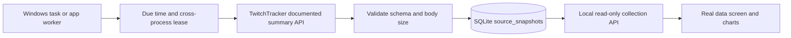

# Real data collection

Upswing now starts on the real-data screen at `/` (also `/data`). It reads persisted public category and streamer summaries from TwitchTracker. The local implementation uses no API key, paid data subscription or hosted service.

## Source choice and cost

| Source                                                                            | Use in Upswing                                                                                                                      | Cost / requirements                                                                                            | Limits                                                                                                                                        |
| --------------------------------------------------------------------------------- | ----------------------------------------------------------------------------------------------------------------------------------- | -------------------------------------------------------------------------------------------------------------- | --------------------------------------------------------------------------------------------------------------------------------------------- |
| [TwitchTracker basic API](https://twitchtracker.com/api)                          | Collect now: category audience/channel averages, rank and watch time; channel audience, peak, streamed minutes and follower metrics | No key or account was required by the verified endpoints; no paid service was created                          | Provider documents 30-day summaries, not title/tag observations or a historical concurrent-viewer feed. No SLA or published quota is assumed. |
| [Twitch Helix Get Streams](https://dev.twitch.tv/docs/api/reference/#get-streams) | Existing direct collector for current viewers, stream IDs, categories, titles and tags                                              | Requires a registered app's Client ID and secret; streamer-by-streamer login is not needed for app-token reads | History begins when your collector starts. Full comparisons need covered windows. Credential setup remains incomplete locally.                |
| [SullyGnome](https://sullygnome.com/about)                                        | Research only                                                                                                                       | No integration added                                                                                           | Its owner asks users not to scrape the site.                                                                                                  |

The current low-cost choice is the documented TwitchTracker API plus SQLite on this PC. Normal internet/power costs still apply. Hourly collection makes at most 16 normal requests per cycle for the starter watchlist (about 384 per full day), with a single retry on a server error. The API is not assumed to be an unlimited service. A 429 response pauses the batch and preserves the provider's cooldown. Increasing the local interval to six hours reduces normal traffic to about 64 requests/day.

Direct Twitch sampling remains the appropriate next source for the project's keyword/tag and current-audience analytics. Rolling summaries cannot replace those raw observations. [Twitch's app-token documentation](https://dev.twitch.tv/docs/authentication/getting-tokens-oauth/#client-credentials-grant-flow) describes the server-side client-credentials flow.

## What is being tracked

The default categories are Just Chatting, League of Legends, VALORANT, Fortnite, Minecraft, World of Warcraft, Hollow Knight: Silksong, Dead by Daylight, Escape from Tarkov, Talk Shows & Podcasts, Art and Phasmophobia. Source keys are the real Twitch category IDs, independent of synthetic fixture IDs.

Starter channels: `shroud`, `pokimane`, `eslcs`, `twitch`. These are a small watchlist, not an exhaustive platform ranking.

Configure your local environment to change the watchlist:

```dotenv
TWITCHTRACKER_ENABLED=true
TWITCHTRACKER_INTERVAL_MIN=60
TWITCHTRACKER_CHANNELS=shroud,pokimane,eslcs,twitch
# Blank means the twelve known categories. Otherwise use up to twenty real numeric Twitch IDs.
TWITCHTRACKER_CATEGORIES=
WORKER=true
```

At most 20 category IDs and 20 channel logins are accepted. Restart the web/standalone worker after changes. The scheduled one-shot command reads `.env` afresh each run. Watchlist removal disables future reads without deleting saved history. Opted-out known channels are excluded from collection and public history.

## Run and inspect

```sh
npm ci
npm run collect:twitchtracker:once
npm run build
npm start
```

Open **http://localhost:3000/**. `npm start` runs the real-data interface and summary worker. With no Twitch keys, the direct collector stays disabled. `/pulse`, Categories and Keywords use actual direct observations in live mode and initially remain empty. `npm run demo` enables synthetic analytics, explicitly labeled, while continuing to expose separate real source data at `/data`.

```sh
npm run collection:status           # Saved records, worker heartbeat, due time, errors
npm run collect:twitchtracker:once  # Poll only when due; no forced quota bypass
npm run collect:twitchtracker       # Standalone continuous worker
```

The browser's **Refresh saved data** button only reads local records. It does not initiate provider requests. Repeated page views do not cause upstream traffic.

## Keep collecting on this Windows PC

```powershell
npm run collection:schedule
```

This registers **Upswing-TwitchTracker-Collection** under the current Windows account with limited privileges and interactive logon. It runs a hidden PowerShell command every 15 minutes and at login. Each invocation checks SQLite's due time, so provider requests remain hourly by default. No Windows password is stored, no elevation is requested, and execution policy is not changed. The first installer invocation also starts the task so its runner can be verified.

The schedule works while the PC is awake, has internet, and that user is logged in. It is not a 24/7 cloud deployment. A missed trigger is eligible to run when available. On login, the task checks again; it does not invent data for missed periods. If the dashboard is also running, a shared database lease and due gate prevent simultaneous provider batches.

Inspect with:

```powershell
Get-ScheduledTask -TaskName Upswing-TwitchTracker-Collection
Get-ScheduledTaskInfo -TaskName Upswing-TwitchTracker-Collection
Get-Content data/collector-scheduled.log
```

The log is overwritten each run to keep it bounded and is gitignored. Exit 0 can mean a successful poll or a correct skip because the batch is not due; inspect `collection:status` for stored results. Partial/provider failures return a nonzero command exit code and retain earlier observations.

Remove this workspace's schedule with `npm run collection:unschedule`. Saved data is retained. The installer refuses to replace an identically named task owned by another workspace. Re-run it if you move the repository or change the installed Node location.

For an always-on environment later, run the same app or standalone collector on a host with persistent storage. Do not put the database on an ephemeral/serverless filesystem and expect durable history. No paid host was provisioned for this task.

## Storage and provenance



`data/upswing.db` stores the live source watchlist, collector state and observations. `data/demo.db` holds synthetic analytics separately. Both are ignored by Git. Snapshots retain provider, entity type/key, fetch timestamp, hourly bucket, metric values, source URL, response SHA-256, and period label. Successful writes are transactional, with at most one row per entity/hour. Reopening the database and restarting the web service preserves the observations.

GET `/api/collection` serves saved metadata/status; GET `/api/collection/history?kind=category&key=509658&range=week` returns at most 1,000 saved observations in the chosen history window. Only enabled, non-opted-out sources are readable. Queries are parameterized, identifiers are validated, and upstream URLs are fixed to documented TwitchTracker endpoints with redirects disabled, bounded bodies and timeouts. Upstream error bodies and credentials are not exposed.

The response bytes are hashed; raw provider responses and databases are not committed. SQLite holds summary metrics, not copied website HTML. Source attribution and fetch times are visible in the UI.

## Reading the charts correctly

- The bar chart compares provider-summary averages across the selected watchlist.
- A time-series point means “this summary value was saved at this fetch time.” One observation is shown as a single point, with a message that history is still accumulating.
- Week/Month on this page selects saved-history length. It does not turn a provider summary into an Upswing Week/Month growth calculation.
- No summary is inserted into `samples`, `game_hourly`, `channel_hourly` or title/tag observations. Existing controlled-growth and opportunity calculations remain unavailable until they have appropriate direct data.
- Missing history is not fabricated. Provider data may be stale, revised or unavailable; failed reads retain prior observations with their original timestamps.

## Local verification evidence

Initial public API collection saved 16 real summaries (12 categories / 4 channels). A fresh production server opened the same database and showed all 16 records. The Windows task was installed and its first run returned `LastTaskResult: 0`, correctly skipping the not-yet-due batch. The foreground worker reported an active heartbeat and next hourly due time. This proves installation and the observed run, not future uptime.

TypeScript, ESLint, **67 tests**, in-process API smoke and the production build passed. Browser checks verified real source labels, category/channel selection, shroud's saved record, a one-row history table, Week/Month history selection, light/dark mode and widths 320/390/768/1024 without overflow or page/console errors. [Desktop](screenshots/real-data-desktop.png), [mobile](screenshots/real-data-mobile.png), and [light-mode](screenshots/real-data-light.png) screenshots show real provider data at their capture time.

The provider adapter tests use explicit fixtures; only the separately recorded local API run is real external evidence. Twitch app registration was performed in the user's account in the prior interrupted turn, but the app secret/local `.env` setup and a direct Helix poll remain unverified. No channel write, OAuth account connection, paid Codex run, cloud deployment or broadcast was performed.
